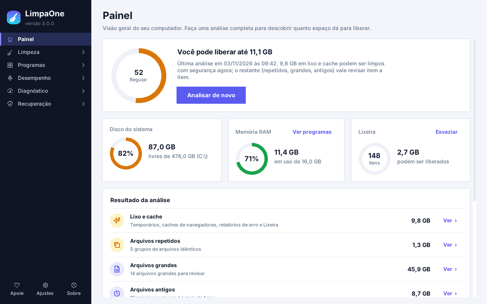

<p align="center"></p>
<h1 align="center">LimpaOne</h1>
<p align="center"><b>Limpeza, otimização e recuperação de arquivos para Windows — tudo num app só.</b><br>
Gratuito · código aberto · sem anúncios · sem coleta de dados · por <a href="https://sarzitecnologia.com.br">Sarzi Tecnologia</a></p>

<p align="center">
  <a href="https://limpaone.sarzitecnologia.com.br"><b>🌐 Site oficial</b></a> ·
  <a href="https://github.com/gabrielsarzi/teste/releases/latest/download/LimpaOne-Setup.exe"><b>⬇ Instalador</b></a> ·
  <a href="https://github.com/gabrielsarzi/teste/releases/latest/download/LimpaOne.exe"><b>⬇ Versão portátil</b></a>
</p>

<p align="center"></p>

## Funções

**Limpeza** — lixo e cache (temporários, navegadores, Windows Update, relatórios de erro…), privacidade (histórico,
cookies, recentes), limpeza do registro com backup, mapa do disco, arquivos grandes, repetidos e antigos, e limpeza
automática agendada.

**Programas** — desinstalador com remoção de sobras e desinstalação forçada, atualizar programas em 1 clique,
instalar programas em lote (com gerador de *kit pós-formatação*), apps da Microsoft Store/bloatware, restos de
programas e inicialização.

**Desempenho** — memória RAM, otimizar Windows (ajustes reversíveis), otimizar discos (TRIM no SSD,
desfragmentação no HD), drivers pelo Windows Update (com backup) e ferramentas do Windows (reparo SFC/DISM,
verificação de disco, relatório da bateria…).

**Diagnóstico** — Meu computador (ficha técnica completa), teste de desempenho com nota e velocidade da internet.

**Recuperação** — restaurar da Lixeira, recuperar arquivos apagados (leitura direta do NTFS + busca por assinatura em
pendrives e cartões) e destruidor de arquivos.

Também: modo claro/escuro, menu em grupos, busca e exportação CSV nas listas, histórico de ações e aviso de nova versão.

## Segurança
Lixeira por padrão · pastas do sistema protegidas · backup do registro antes de qualquer alteração · confirmação antes
de cada ação · histórico em `%LOCALAPPDATA%\LimpaOne\historico.log` · nada sai do seu PC (internet só para checar
atualizações e baixar programas pelo winget).

## Desenvolvimento
```bash
pip install -r requirements.txt
python main.py                # abre o app
python main.py --auto-clean   # limpeza silenciosa (usada pelo agendamento)
```
- `limpaone/` — código do app (uma página por módulo: `pages.py`, `apps_pages.py`, `hw_pages.py`, `test_pages.py`,
  `optimize_pages.py`, `uninstall_pages.py`, `recovery_pages.py`, `donate.py`…).
- `limpaone/donate.py` — **configure aqui o PIX e os links de doação**.
- `site/` — página oficial (publicação no Cloudflare Pages: veja `site/DEPLOY.md`).
- `tools/screenshots.py` — gera os prints do site; `tools/preview.py` — abre uma página isolada.
- Cada push em `limpeza-pc/` gera o `.exe` e o instalador e publica uma versão em Releases (GitHub Actions).

## Licença
[MIT](LICENSE) — © Gabriel Sarzi / Sarzi Tecnologia.
